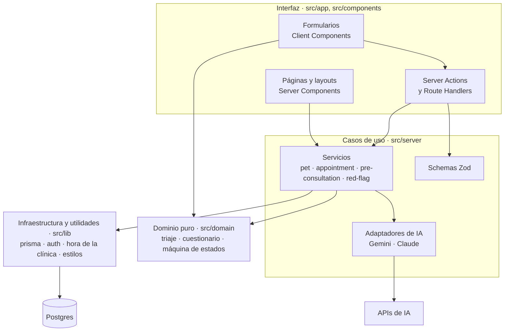
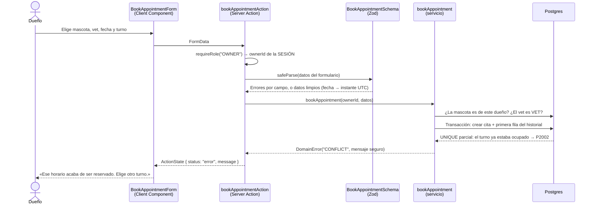

# Arquitectura de SalusVet

SalusVet es la aplicación de una clínica veterinaria en Loja, Ecuador. Los dueños registran mascotas, agendan citas y completan una pre-consulta (con IA o con un cuestionario gratuito). Los veterinarios ven su agenda con el triaje de cada cita y mantienen la lista de alertas clínicas.

**Stack:** Next.js 16 (App Router, Server Actions, Partial Prerendering) · TypeScript · Prisma 7 · Postgres (Neon) · Better Auth · Zod · Tailwind CSS v4.

Este documento explica **cómo está organizado el código y por qué**. Las reglas de dependencia no viven solo aquí: [`eslint.config.mjs`](../eslint.config.mjs) las hace cumplir en cada `npm run lint`.

---

## 1. Las capas

Las flechas apuntan **hacia abajo**: cada capa conoce a las de abajo, nunca a las de arriba.

| Capa | Responsabilidad | Puede importar | Nunca importa |
|---|---|---|---|
| `app/`, `components/` | Mostrar datos, recibir formularios, traducir errores a mensajes | `server/`, `domain/`, `lib/` (utilidades) | Prisma, SDK de IA |
| `server/` | Casos de uso: autorización, reglas que necesitan la BD, transacciones | `domain/`, `lib/`, Prisma | `app/`, `components/` |
| `server/pre-consultation/ai/` | Hablar con un proveedor de IA concreto | SDK de su proveedor | `app/`, `components/` |
| `domain/` | Reglas de negocio **puras**: misma entrada → misma salida | enums de Prisma, Zod | BD, framework, sesión, `server/`, UI |
| `lib/` | Conexiones (BD, auth) y utilidades sin negocio | enums de Prisma | `server/`, UI |

### ¿Por qué `domain/` es una capa aparte?

Hay reglas que necesitan **los dos lados**. La máquina de estados de las citas la usa el servidor para *autorizar* («¿puede el dueño cancelar?») y la interfaz para *decidir qué botones mostrar*. Si viviera en `server/`, el nombre de la carpeta mentiría: ese código también llega al navegador. Y si alguien le agregara un import de Prisma, rompería el bundle del cliente.

`domain/` es la promesa explícita: **sin E/S, sin framework, sin sesión**. Por eso:

- se ejecuta igual en el servidor y en el navegador;
- se puede probar con tests simples, sin BD ni servidor;
- ESLint rechaza cualquier import que rompa la promesa.

---

## 2. Cómo viaja una petición

Ejemplo: un dueño agenda una cita.

Cada pieza tiene **un solo trabajo**:

- **La action** es la puerta: verifica la sesión, valida la forma de los datos y traduce el resultado al formulario. No contiene reglas de negocio.
- **Zod** valida lo que se puede comprobar mirando solo el valor: formato, rango, turno de 30 minutos, fecha futura.
- **El servicio** valida lo que necesita la BD (que la mascota sea tuya) y nunca confía en quien lo llama: recibe el `ownerId` de la sesión, no del formulario.
- **La BD** tiene la última palabra en las condiciones de carrera: dos dueños pidiendo el mismo turno a la vez.

---

## 3. Decisiones clave

### Defensa en profundidad

Una regla importante se comprueba en **varias capas**, porque cualquier capa de arriba se puede saltar.

| Regla | UI | Servicio | Base de datos |
|---|---|---|---|
| Un turno por vet | Solo ofrece turnos válidos | Traduce el conflicto a un mensaje | `UNIQUE (vetId, scheduledAt)` parcial, solo para citas activas |
| Ver solo lo tuyo | Muestra solo tus datos | Filtra por `ownerId` (si no es tuyo, 404 y no 403) | — |
| Cuatro ojos en alertas | Oculta «Aprobar» a quien pidió la baja | `WHERE` atómico en el `updateMany` | `CHECK` aprobador ≠ solicitante |
| Alerta protegida | Sin botón de baja | `WHERE locked = false` | `CHECK (NOT locked OR active)` |

Ocultar un botón es **comodidad**, no seguridad: cualquiera puede enviar la petición a mano.

### Reglas en el `WHERE`, no en un `if`

Leer una fila, comprobar algo en código y después escribir deja una ventana (TOCTOU): otra petición puede cambiar la fila entre medio. Por eso las transiciones críticas usan `updateMany({ where: { id, ...condiciones } })`. Postgres comprueba y escribe en una sola operación, y `count === 0` significa que la condición ya no se cumplía.

### «La IA propone, el código dispone»

La pre-consulta puede usar un modelo de lenguaje, pero **la urgencia final nunca depende solo de él**:

1. Las señales de alarma (`domain/triage.ts`) se detectan con reglas deterministas, antes de llamar a la IA.
2. La urgencia final es el **máximo** entre lo que propone la IA (o el cuestionario) y lo que dicen las reglas.
3. La lista base vive en el código y se revisa como código. Los vets solo pueden **agregar** alertas desde la interfaz; desactivar una exige que la apruebe otra persona.

Si la IA falla o no está configurada, el dueño usa el cuestionario guiado. Cuesta $0 y nunca bloquea a nadie.

### Puertos y adaptadores para la IA

El servicio de pre-consulta depende de la interfaz `PreConsultationAI` (`streamReply`, `summarize`), no de un proveedor. Gemini (gratis) y Claude (de pago) son **adaptadores** intercambiables, y se elige uno con `AI_PROVIDER` en `.env`. Cambiar de proveedor no toca el servicio, y ESLint impide importar un SDK de IA fuera de `server/pre-consultation/ai/`.

### Fechas: UTC en la BD, hora de la clínica en la interfaz

La BD guarda instantes en UTC. Todo lo que se muestra o se valida («turno entre 08:00 y 17:30») usa `America/Guayaquil` (`lib/clinic-time.ts`), sin importar dónde corra el servidor ni el navegador del usuario.

### Historial que no se pierde

- **Soft delete** de usuarios y mascotas (`deletedAt`): «borrar» no rompe el historial clínico.
- `AppointmentStatusChange` guarda cada cambio de estado: quién, de qué a qué y cuándo.
- Las alertas guardan quién las creó, quién pidió la baja, el motivo y quién la aprobó.

---

## 4. Cómo se hacen cumplir las fronteras

| Mecanismo | Qué impide | Cuándo avisa |
|---|---|---|
| `import "server-only"` | Que código de servidor (secretos, Prisma) llegue al navegador | Al compilar (`next build`) |
| ESLint `no-restricted-imports` | Romper la dirección de las capas | En el editor, en `npm run lint` y en CI |
| TypeScript estricto | Datos con forma incorrecta entre capas | En el editor y en `tsc` |
| Restricciones de Postgres | Datos inválidos, venga de donde venga la escritura | En cada escritura |

---

## 5. Agregar una funcionalidad

Ejemplo: vacunas de cada mascota.

1. **Modelo:** agregar el modelo en `prisma/schema.prisma` y crear una migración *aditiva* (columnas nuevas opcionales o con `DEFAULT`).
2. **Reglas puras:** si hay reglas sin E/S (por ejemplo, calcular la próxima dosis), van en `domain/` y se testean solas.
3. **Validación:** el schema Zod va en `server/<feature>/<feature>.schemas.ts`.
4. **Caso de uso:** el servicio va en `server/<feature>/<feature>.service.ts` con `import "server-only"`. Recibe el usuario de la sesión, autoriza y filtra por dueño.
5. **Entrada:** la Server Action en `app/.../actions.ts` solo hace sesión → Zod → servicio → `ActionState`.
6. **Interfaz:** la página (Server Component) y el formulario (Client Component con `useActionState`), usando `buttonClass()` y los tokens del tema.
7. **Verificar:** `npx tsc --noEmit`, `npm run lint` y probar el flujo en el navegador.

---

## 6. Deuda conocida y próximos pasos

| Tema | Riesgo | Plan |
|---|---|---|
| **Sin tests automáticos** | Un cambio en el triaje o en las transiciones puede romper algo sin que nadie lo note | Vitest para `domain/`, que no necesita BD |
| **Sin rate limiting** en `/api/pre-consultation` | Abuso de la cuota de IA | Límite por usuario y por IP |
| **Sin verificación de email** | Cuentas con correos falsos | Better Auth + Resend |
| **Sin CI** | Las reglas solo se cumplen si alguien corre lint | GitHub Actions: `tsc`, lint y build en cada PR |
| La conversación de la pre-consulta viaja desde el navegador | El cliente reenvía todo el historial en cada mensaje | Guardar los mensajes en el servidor |
| `sslmode=require` en la conexión | Aviso de `pg`: cambiará de significado en la próxima versión | Usar `sslmode=verify-full` |
